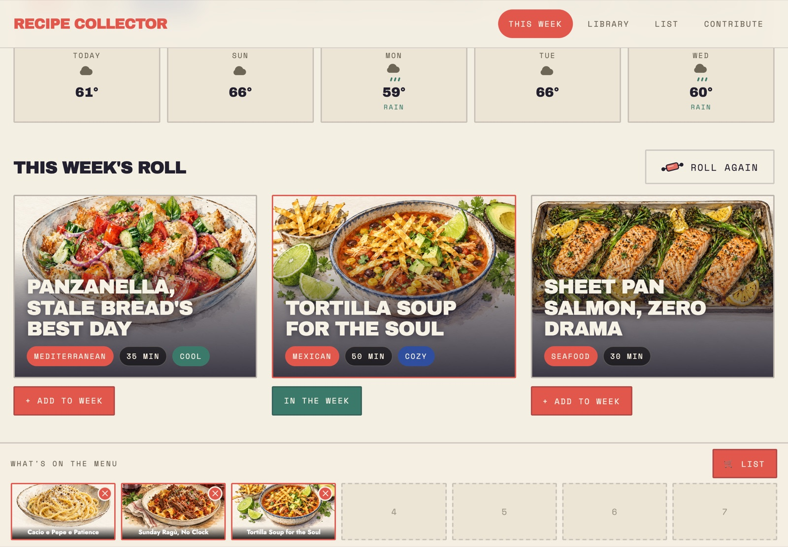
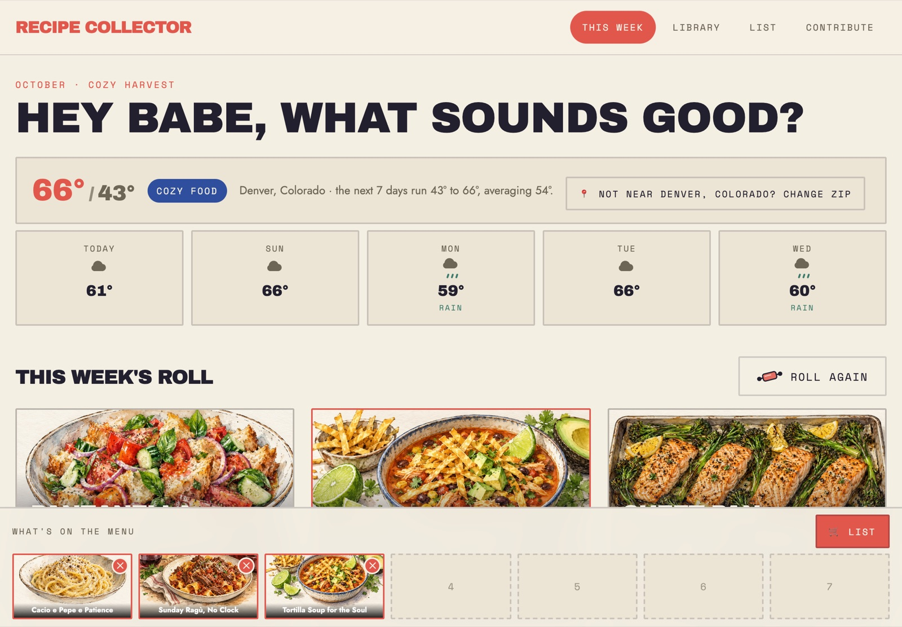
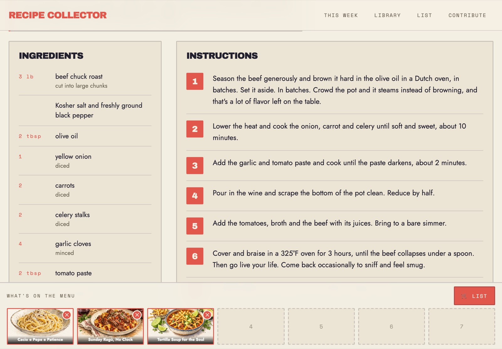
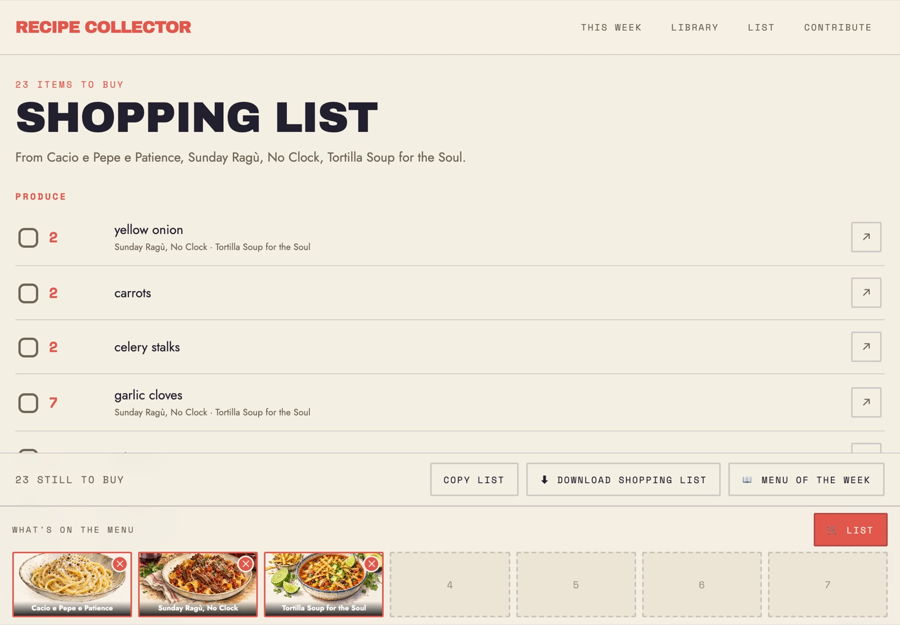
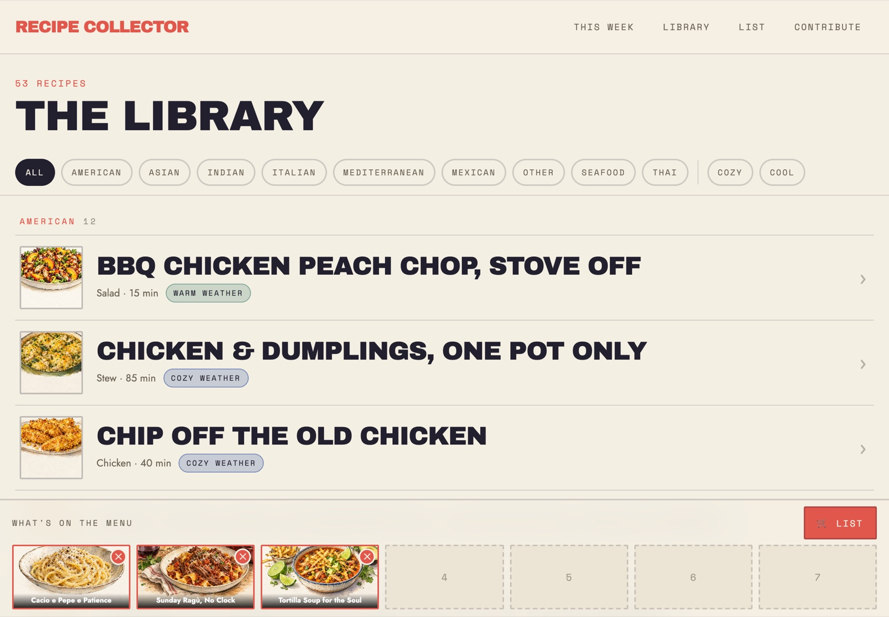
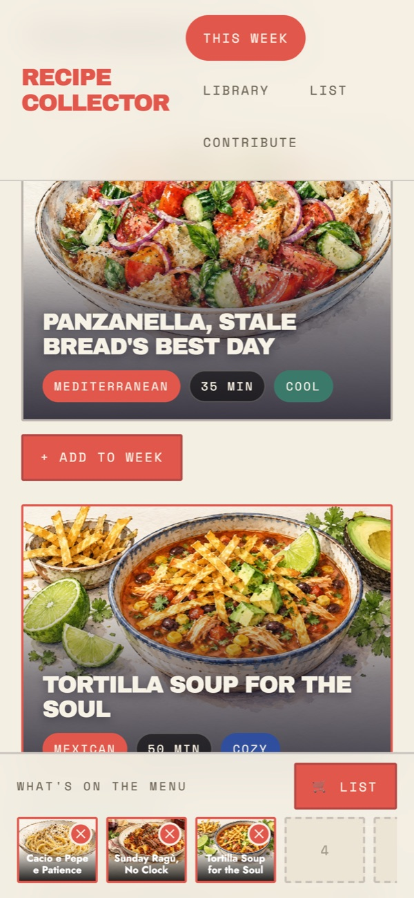

# Recipe Collector

**Seven dinners a week, picked for the weather.** A kitchen app for the counter iPad that answers
the nightly question, "Hey babe, what sounds good?"



Photograph a cookbook page (or paste a link) and it becomes a recipe with its own watercolor card,
rewritten in one warm, bossy house voice. Each week it deals three dinners from three different
cuisines, chosen for the temperature outside. Drop the ones you like into the week's seven slots
and it builds the shopping list, sorted by store aisle with your pantry staples left off. If you
shop at a Kroger-family store, one tap puts the whole list in your delivery cart.

It's the code behind [heybabewhatsoundsgood.com](https://heybabewhatsoundsgood.com), with five
house recipes to start you off. Everything runs on your own computer; the iPad or phone opens it
over your home Wi-Fi, and your recipes are plain text files you own.

## A quick tour

| | |
| :-- | :-- |
|  |  |
| **This week.** The forecast for your zip decides the mood: under 60°F it deals braises and soups, above it salads and grilled fish. | **Every recipe, one voice.** Ingredients and amounts stay exactly as the source wrote them; the steps get a friend leaning on the counter. |
|  |  |
| **The list.** Merged across the week, grouped by aisle, pantry staples left off. Copy it, print a one-page store map or a menu booklet, or send it to your cart. | **The library.** Every recipe by cuisine, filterable by cuisine and by cozy or cool weather. |

<p align="center">
  
  <br />
  <em>Add it to your home screen and it opens fullscreen like an app.</em>
</p>

## The quick way

Open [Claude Code](https://claude.com/claude-code) (or Codex) in an empty folder and paste:

```text
Clone https://github.com/cdoelling/recipe-collector-starter into this folder. Read README.md and
AGENTS.md first, then set it up for me step by step: ask for my zip code and grocery store and
update lib/home.js, help me get an Anthropic API key and write .env.local, install, start it, and
give me the address to open on my iPad or phone. Then walk me through importing my first recipe
from a photo. Ask whether I want to rename the app or change the house voice in docs/VOICE.md.
```

## Run it by hand

You need [Node.js](https://nodejs.org) 20 or newer and git.

```bash
git clone https://github.com/cdoelling/recipe-collector-starter.git
cd recipe-collector-starter
npm install
cp .env.local.example .env.local   # then paste your Anthropic key into it
npm run dev
```

Open <http://localhost:3001>. On a tablet or phone on the same Wi-Fi, use your computer's LAN
address instead (on a Mac, `ipconfig getifaddr en0`), port 3001. In Safari, Share → **Add to
Home Screen** opens it fullscreen like an app.

`npm run dev` listens on your whole network so the tablet can reach it. For a computer-only
session use `npx next dev -H 127.0.0.1 -p 3001`.

## Make it yours

| What | Where |
| :-- | :-- |
| Your zip, town and coordinates (weather), your Kroger banner and its website | `lib/home.js` |
| API keys | `.env.local` (copy `.env.local.example`; never committed) |
| The house voice every recipe is rewritten in, titles included | `docs/VOICE.md` |
| Headlines ("Hey Babe, what sounds good?") | `app/page.js`, `components/ShareHome.jsx`, `components/StoreMapPrint.jsx`, `lib/menu-theme.js` |
| Pantry staples left off the list | the **Pantry** page, saved to `data/pantry.json` |
| Cozy/cool cutoff (60°F) | `COZY_THRESHOLD` in `lib/weather.js` |

The five house recipes in `data/recipes/` are marked `starter: true`. Keep them or delete them
once your own are in.

## What it does

- **Recipes are markdown files** in `data/recipes/`. No database: edit any of them in a text
  editor and the app picks it up on the next page load. `weather:` is `cozy` (offered under
  60°F), `cool` (60°F and up) or `any`.
- **Add** takes photos, a PDF or a link. Claude reads it, writes the recipe in the house voice,
  then fact-checks it against the source: clear-cut transcription errors are fixed in place,
  judgment calls become notes on the recipe page. Without an API key, photos queue in
  `data/inbox/` until you run `npm run transcribe`.
- **Card pictures** are pen-and-ink-and-watercolor illustrations drawn by the
  [Codex CLI](https://github.com/openai/codex) in the background after each import. Without Codex
  installed and logged in, cards use procedural SVG art in whichever style is active.
- **The weekly roll** deals three cards from three cuisines, filtered by live weather from
  [Open-Meteo](https://open-meteo.com) (free, no key).
- **The shopping list** merges ingredients across the week, sums matching units, sorts by store
  aisle and drops pantry staples. It prints as a menu booklet or a one-page store map.
- **Grocery cart (optional).** Kroger-family stores have a free developer API. Register an app at
  <https://developer.kroger.com> with redirect URI `http://localhost:3001/api/kroger/callback` and
  scopes `product.compact cart.basic:write profile.compact`, put the three values in `.env.local`,
  and **Send to cart** on the List page fills your cart. You still pick a slot and check out
  yourself. Other grocers: **Copy list** and print still work.
- **A read-only share site** for friends: `npm run build:share` writes static pages to `out/`
  (each visitor's week lives in their own browser) for GitHub Pages or any static host;
  `npm run preview:share` serves it on port 3002.

## Costs

The app itself is free. An Anthropic API key pays per use: reading and fact-checking a recipe is
a few cents. Card pictures use your Codex/ChatGPT plan's quota. Kroger's API and Open-Meteo are
free.

## Layout

```
app/          pages and API routes (*.share.js are the share site's pages)
components/   the interactive parts: roll, dock, capture, list, print layouts
lib/          recipes, roll, weather, grocery sorting, Claude calls, Kroger, card art
docs/VOICE.md the house voice
data/         recipes/, inbox/ (uploads, gitignored), pantry.json, week.json
public/       recipe-art/ (generated card pictures)
scripts/      npm run transcribe, npm run check
```

## License

MIT. See [LICENSE](LICENSE).
